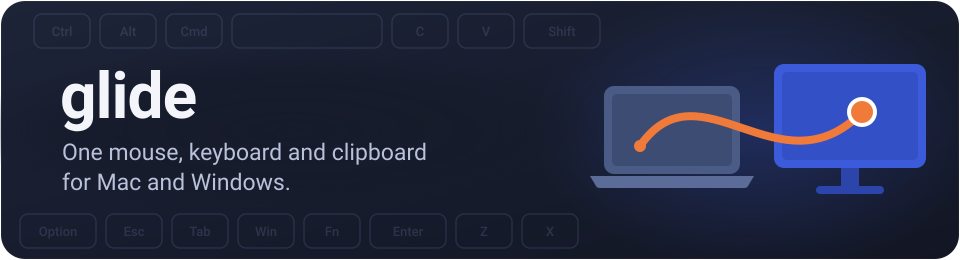
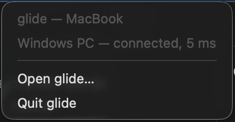
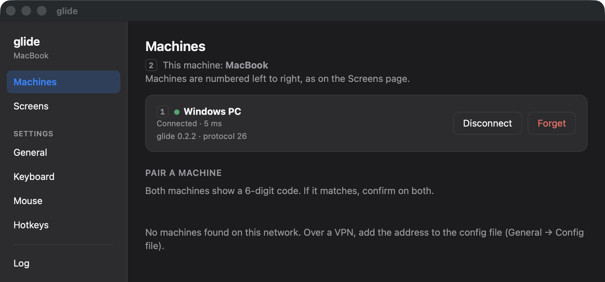
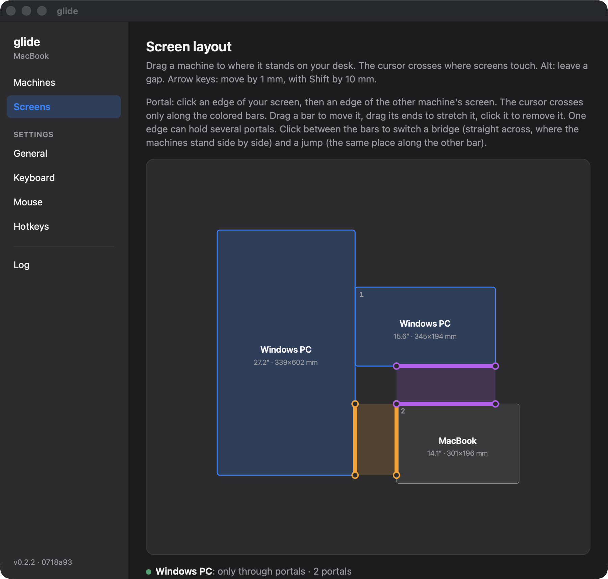
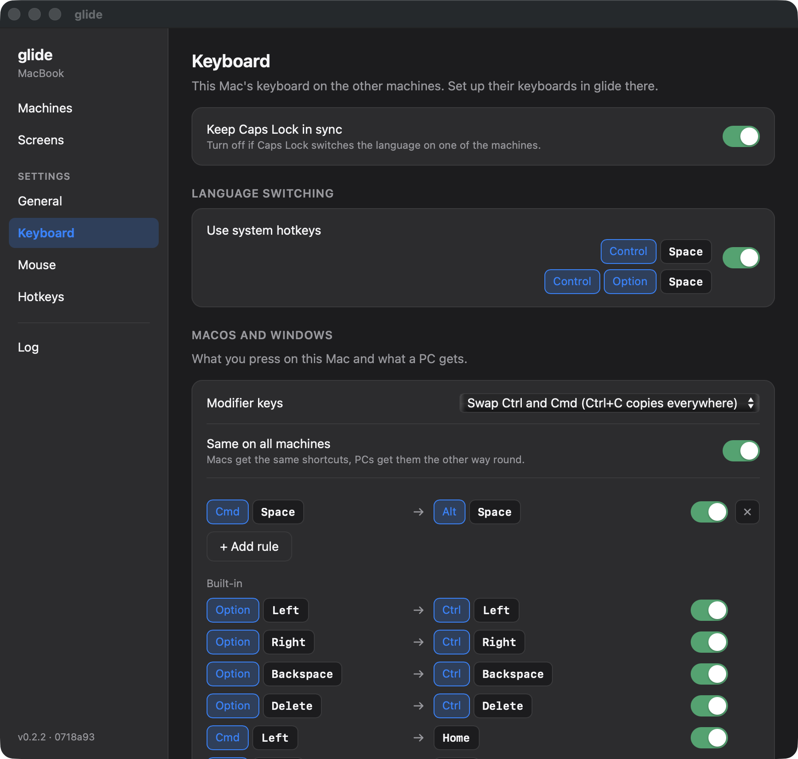
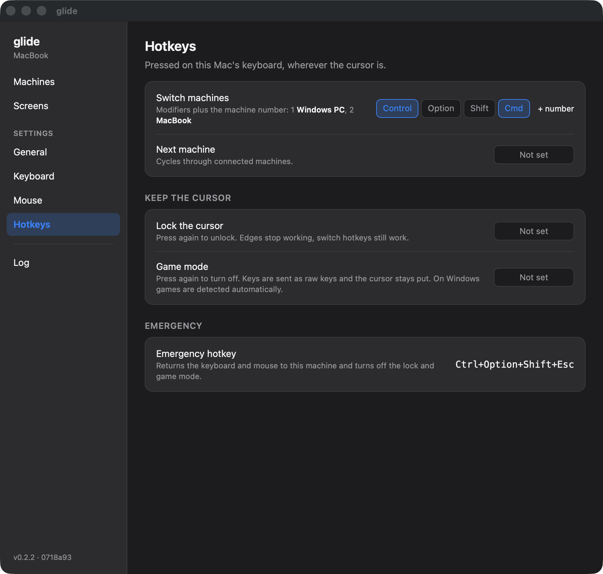

  

# glide

glide lets a Mac and a Windows PC share one mouse, keyboard and clipboard. When the cursor reaches the edge of one screen, it moves on to the other machine, and the keyboard types there.

## Download

Download the [latest release](https://github.com/max-fluff/glide-releases/releases/latest) and install it on each machine. The machines must be on the same local network or VPN.

| System | File |
|---|---|
| Windows 10 or 11 | `glide-setup-x64.exe` |
| macOS 13 or later, Apple silicon | `glide-macos-arm64.dmg` |
| macOS 13 or later, Intel | `glide-macos-x64.dmg` |

## Features

- The cursor moves between screens where they touch, the way you placed them in glide. You can connect more than two machines, each with several monitors.
- Typed text uses the input language of the keyboard you type on, so you only switch languages on that machine.
- Ctrl and Cmd can be swapped so Ctrl+C copies on both systems. You can also add your own shortcut rules, for example Cmd+Space on the Mac sends Alt+Space to the PC.
- The clipboard is shared: text, images and files. Big files are transferred when you paste them. Passwords copied from password managers stay on their machine.
- You can drag files, text and images to the edge of the screen and drop them on the other machine.
- Hotkeys switch to a machine by its number, lock the cursor on the current machine, or turn on game mode. On Windows, glide notices games by itself.
- glide can wake a sleeping machine when you move the cursor to it, if its network card supports Wake-on-LAN. It can also lock all machines when one of them locks.
- glide checks for new versions and installs them when you click Update now.

## Install

### Windows

Run `glide-setup-x64.exe`. The installer puts glide in Program Files, allows it in the firewall for private networks and starts it. glide is signed with its own certificate, so the first time you install it, SmartScreen and UAC say the publisher is unknown.

If Windows lists your network as public, change it to private. Otherwise the other machines can't connect.

### macOS

Open the disk image and drag glide to Applications.

The app isn't notarized by Apple, so macOS blocks it the first time. Go to System Settings > Privacy & Security and click Open Anyway next to the message about glide. You have to do this for every version you download with a browser. Updates installed from inside glide don't need it.

Then allow glide in Privacy & Security under Accessibility and Input Monitoring, and start it again. You don't have to do this again after updates.

To paste or drop files from another machine on the Mac, turn on glide in System Settings > General > Login Items & Extensions > File Providers. This needs macOS 15 or later.

## Getting started

1. Start glide on both machines. On the Mac it is in the menu bar, on Windows in the tray. Click Open glide to open its window.

   

2. On the Machines page, the other machine shows up under Pair a machine. Click Pair. Both machines show a 6-digit code. If the codes are the same, click Confirm on both.

   After that the machine is in the list as connected:

   

3. On the Screens page, drag each screen to where it is on your desk. The cursor crosses where screens touch. If it should cross only part of an edge, add a portal there: in the picture, the orange and purple bars are portals.

   

glide doesn't find machines over a VPN by itself. Add the other machine's address to the config file, which you can open from General > Config file.

## Keyboard

The Keyboard page sets what the other machines receive when you press keys on this one: whether Ctrl and Cmd are swapped, your shortcut rules, and how the input language is switched. Some Mac text shortcuts are converted for Windows by default, for example Option+Left, which moves one word back.

## Hotkeys

A hotkey works on the machine whose keyboard you press it on, wherever the cursor is at the moment.

If a key gets stuck or the cursor doesn't come back, press Ctrl+Alt+Shift+Esc (Ctrl+Option+Shift+Esc on the Mac). The keyboard and mouse go back to the machine you pressed it on.

## Security

glide doesn't use accounts or outside servers. The machines connect to each other directly. Each machine has its own certificate, and glide only accepts input and clipboard data from machines you paired with the code. Connections are encrypted with TLS 1.3, over QUIC or over TCP when UDP is blocked.

## Limitations

- On Windows, glide doesn't work on the lock screen, in UAC prompts or on the Ctrl+Alt+Del screen.
- On the Mac, glide can't tell when a game is running. Use the game mode hotkey.

## Troubleshooting

- If the machines don't see each other, check that they are on the same network and that the Windows network is set to private.
- If the cursor doesn't cross, look under the layout on the Screens page. It says what holds the cursor: a cursor lock, game mode or a full screen app.
- The Log page in the window shows what glide did. The file `glide.log` is in `%APPDATA%\glide` on Windows and in `~/Library/Application Support/glide` on the Mac.
